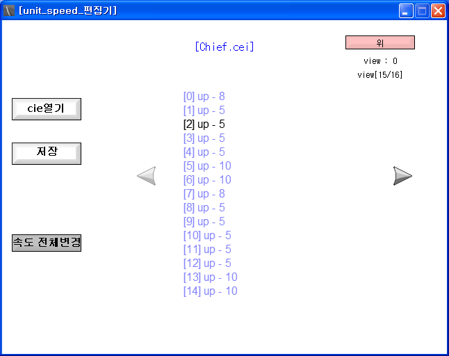

# 쥬라기원시전2 유닛속도편집기

[English](README.md)

쥬라기원시전2 유닛의 이동속도는 능력치 파일(CEI) 안에 애니메이션 프레임마다 적혀 있다. 그 값을 목록으로 늘어놓고 골라서 고치는 편집기다.

분석 결과는 [docs/cei-speed-format.ko.md](docs/cei-speed-format.ko.md) 에 정리해뒀다.

<p>
  
</p>


## 사용 방법

Releases에서 받아 압축을 풀고 실행하면 바로 파일 선택창이 뜬다. 유닛의 `.cei` 파일을 고르면 프레임별 속도가 목록으로 나온다.

오른쪽 위 버튼으로 여덟 방향 중 어느 쪽을 볼지 고른다. 목록은 한 번에 15개씩 보이고 양옆 화살표로 넘긴다.

목록의 줄을 클릭하면 상하 방향과 좌우 방향을 차례로 물어보고 받은 숫자로 값을 고친다. `속도 전체변경` 은 지금 보고 있는 방향의 모든 프레임을 한 값으로 맞춘다.

`저장` 을 누르면 원본 CEI에 그대로 덮어쓴다. 되돌릴 방법이 없으니 미리 백업해두는 게 좋다.


## 구현 원리

**속도는 방향마다 따로, 프레임마다 8바이트씩 들어 있다.** CEI의 `0x3CC` 부터 `0x200` 간격으로 여덟 방향 구간이 늘어서 있고 각 구간 안에서 좌우속도 4바이트와 상하속도 4바이트가 한 프레임을 이룬다. 구간이 `0x200` 이라 한 방향당 64프레임이 한계다. 프레임 개수는 속도 구간이 끝나는 `0x13CC` 에서 12바이트 뒤인 `0x13D8` 에 4바이트로 적혀 있어서 그 값을 먼저 읽고 그만큼만 훑는다.

```gml
file_bin_seek(vb_file, 5080)                     // 0x13D8, 프레임 개수
repeat(4){ max_h = sk_hex_conversion(file_bin_read_byte(vb_file)) + max_h }
max_d = sk_dec_conversion(max_h)

for(i=0; i!=8; i+=1)                             // 여덟 방향
{
  file_bin_seek(vb_file, 972+(i*512))            // 0x3CC + i*0x200
  for(j=0; j!=max_d; j+=1)                       // 프레임 수만큼
  {
    ...
  }
}
```

소스에 적힌 `972`, `512`, `5080` 은 전부 10진수다. 분석 자료의 `0x3CC`, `0x200`, `0x13D8` 과 같은 값이다.

**음수를 최상위 바이트로 알아낸다.** 값이 4바이트 부호 있는 정수라서 왼쪽이나 위로 가는 속도는 `FFFFFFxx` 꼴로 저장된다. 그래서 조립한 16진 문자열의 앞 두 자리가 `FF` 인지 보고 맞으면 `256 - 하위바이트` 로 크기를 뽑아 왼쪽·위로 분류한다. 아니면 오른쪽·아래다. 덕분에 화면에는 부호 대신 방향 이름이 나온다.

```gml
vb_read=""
repeat(4){ vb_read = sk_hex_conversion(file_bin_read_byte(vb_file)) + vb_read }

if string_delete(vb_read, 3, string_length(vb_read))="FF"
{ left[i, j] = 256 - sk_dec_conversion(string_delete(vb_read, 1, 6)) }
else
{ right[i, j] = sk_dec_conversion(string_delete(vb_read, 1, 6)) }
```

**저장할 때는 그 변환을 거꾸로 돌린다.** 왼쪽이나 위 값이 들어 있으면 `256 - 값` 을 하위 바이트로 쓰고 나머지 세 바이트를 `FF` 로 채운다. 오른쪽이나 아래면 값을 그대로 쓰고 세 바이트에는 `0` 을 넣는다. 양쪽 다 0이면 네 바이트 전부 0이다.

```gml
if left[i, j]!=0
{
  file_bin_write_byte(vb_file, left[i, j]+(256-(left[i, j]*2)))
  file_bin_write_byte(vb_file, 255)
  file_bin_write_byte(vb_file, 255)
  file_bin_write_byte(vb_file, 255)
}
```

한 프레임에 위와 아래를 같이 넣을 수는 없고 좌우도 마찬가지라 하나를 채우면 반대쪽은 0으로 지운다. 입력값은 255에서 잘린다.


## 파일

| 경로 | 내용 |
|---|---|
| `source/jw2-unit-speed-editor.gmk` | 원본 프로젝트 파일 |
| `source/split/` | GmkSplitter로 분해한 텍스트 트리 |
| `docs/cei-speed-format.ko.md` | CEI 이동속도 오프셋 분석 자료 |
| `docs/screenshots/` | 스크린샷 |
| Releases | 실행 파일과 사용 설명 |


## 크레딧

한글 출력 스크립트(`source/split/Scripts/sefx_v2_0/`)는 게임메이커 커뮤니티의 김게맛(sodium031)님이 만든 것이다.


## 라이선스

zlib 라이선스다. 자세한 내용은 [LICENSE](LICENSE) 에 있다. 함께 들어 있는 것 중 다른 사람이 만든 라이브러리는 각자의 라이선스를 따른다.
